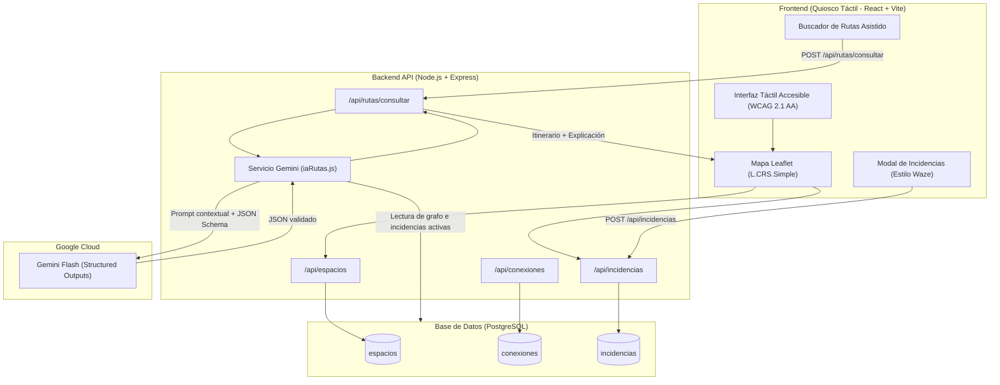
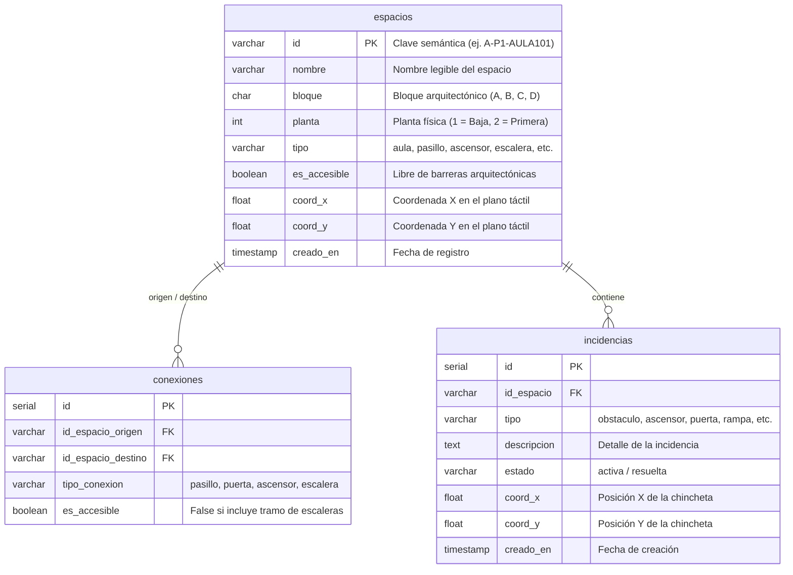

# AccessiRoute
## Sistema de Navegación Interior Accesible con IA y Reporte Colaborativo
**Proyecto de Fin de Ciclo Formativo de Grado Superior en Desarrollo de Aplicaciones Web (DAW)**

---

## 1. Visión General del Proyecto

**AccessiRoute** es una aplicación web progresiva (**PWA**) concebida para terminales y quioscos táctiles de pared ubicados en accesos y pasillos de centros educativos. Resuelve de forma integral la orientación en interiores y la accesibilidad arquitectónica combinando:

1. **Cartografía de interiores en 2D**: Visualización limpia y esquemática de las plantas del edificio mediante un plano interactivo sin depender de GPS satelital ni conexión móvil.
2. **Motor de rutas asistido por IA (Google Gemini API)**: Cálculo de itinerarios óptimos que respetan las normas de accesibilidad universal (personas en silla de ruedas, movilidad reducida, muletas o carritos de bebé), evitando tramos de escaleras y priorizando ascensores y rampas.
3. **Gestión colaborativa de incidencias (estilo Waze)**: Sistema táctil ágil que permite a cualquier usuario marcar en pocos segundos una avería de ascensor, un pasillo bloqueado o un obstáculo directamente tocando el plano.
4. **Respuesta dinámica en tiempo real**: Las rutas generadas por la IA integran al instante las incidencias activas almacenadas en PostgreSQL para esquivar zonas impracticables.

---

## 2. Arquitectura Global del Sistema



---

## 3. Pila Tecnológica y Justificación Técnica

| Capa | Tecnología | Lenguaje | Justificación Técnica |
|---|---|---|---|
| **Base de Datos** | **PostgreSQL** | SQL | Estructura relacional con claves foráneas e integridad referencial (`ON DELETE CASCADE`). Permite modelar el centro educativo como un **grafo matemático** (nodos en `espacios` y aristas en `conexiones`). |
| **Backend** | **Node.js + Express** | JavaScript (ESM) | Entorno no bloqueante orientado a eventos. Gestión eficiente de peticiones concurrentes y pool de conexiones a PostgreSQL mediante la biblioteca `pg`. |
| **Inteligencia Artificial** | **Google Gemini API** (`@google/genai`) | JSON / Prompting estructurado | Capacidad de razonamiento sobre grafos topológicos y salida forzada mediante **Structured Outputs** (`Type.OBJECT`), eliminando alucinaciones y garantizando formato JSON estricto. |
| **Frontend** | **React + Vite** | JavaScript (JSX) + CSS3 | **React** desacopla el estado del mapa, los marcadores y los diálogos táctiles. **Vite** proporciona compilación ultrarrápida con Hot Module Replacement (HMR). |
| **Cartografía** | **Leaflet + React-Leaflet** | JavaScript | Sistema de coordenadas planas `L.CRS.Simple` (0 a 1000). Ligero (~40 KB), sin dependencias cartográficas externas ni consumo de cuotas de mapas comerciales. |
| **Accesibilidad** | **CSS3 Moderno + PWA** | CSS3 / HTML5 / Web APIs | Cumplimiento del estándar **WCAG 2.1 AA**: objetivos táctiles mínimos de 48px, alto contraste (superior a 4.5:1) y configuración `manifest.json` con `"display": "standalone"` para modo quiosco. |

---

## 4. Modelo de Datos y Grafo de Navegación

### Tablas Principales (PostgreSQL)



---

## 5. Módulos y Funcionamiento Detallado

### 5.1. Cartografía Interior con Leaflet (`L.CRS.Simple`)
A diferencia de aplicaciones de exterior, los edificios no se posicionan con coordenadas geográficas (latitud/longitud), ya que el GPS bajo cubierta carece de precisión. 
AccessiRoute implementa `L.CRS.Simple`, definiendo un sistema cartesiano euclidiano bidimensional relativo $[0, 0]$ a $[1000, 1000]$:
- Las aulas, aseos, escaleras y ascensores se sitúan con precisión milimétrica mediante sus coordenadas relativas.
- Selector de plantas flotante (Planta 1 y Planta 2) que conmuta la visibilidad de los espacios y la ruta activa.
- Trazado dinámico del itinerario mediante `Polyline` animada sobre el plano.

### 5.2. Motor de Rutas con IA y Structured Outputs
1. El usuario introduce una petición en lenguaje natural (ej. *"Tengo muletas y quiero ir desde secretaría hasta el aula A-08"*).
2. El backend consulta el estado actual del grafo y las incidencias activas en PostgreSQL.
3. Se inyecta la topología en el prompt del sistema junto con el esquema JSON estricto (`Type.OBJECT` con `origen`, `destino`, `ruta`, `barreras_evitadas` y `motivo`).
4. Gemini Flash calcula el itinerario respetando las restricciones de movilidad y evitando nodos con incidencias activas.
5. El servicio cuenta con un mecanismo de reintento automático (*fallback*) entre modelos (`gemini-3.5-flash`, `gemini-3.7-flash` y `gemini-3.8-flash`) para garantizar tolerancia a picos de carga.

### 5.3. Sistema Colaborativo de Incidencias (Estilo Waze)
1. El usuario pulsa el botón **Reportar**.
2. Selecciona uno de los 6 tipos en una cuadrícula táctil ergonómica: *Obstáculo, Ascensor, Puerta, Rampa, Paso Bloqueado* u *Otro*.
3. El plano pasa a modo reporte activo. Al tocar cualquier punto, se posiciona una chincheta roja temporal.
4. El sistema determina el espacio más cercano mediante distancia euclidiana:
   $$\text{distancia} = \sqrt{(x_2 - x_1)^2 + (y_2 - y_1)^2}$$
5. Al pulsar **Confirmar Incidencia**, se registra en PostgreSQL mediante `POST /api/incidencias` y se refleja inmediatamente en el plano para ser tenida en cuenta por el motor de IA.

---

## 6. Endpoints de la API REST

| Método | Endpoint | Descripción | Parámetros / Cuerpo |
|---|---|---|---|
| `GET` | `/api/health` | Estado del backend | Ninguno |
| `GET` | `/api/espacios` | Lista de todos los espacios | Ninguno |
| `GET` | `/api/espacios/:id` | Detalle de un espacio | `id` en URL |
| `GET` | `/api/conexiones` | Grafo de conexiones | Ninguno |
| `GET` | `/api/incidencias` | Lista de incidencias activas | `?estado=activa` (opcional) |
| `POST` | `/api/incidencias` | Registrar nueva incidencia | `{ id_espacio, tipo, coord_x, coord_y, descripcion }` |
| `PATCH` | `/api/incidencias/:id/resolver` | Resolver incidencia | `id` en URL |
| `DELETE` | `/api/incidencias/:id` | Eliminar incidencia | `id` en URL |
| `POST` | `/api/rutas/consultar` | Cálculo de ruta con IA | `{ peticionUsuario, soloAccesible, idOrigenForzado, idDestinoForzado }` |

---

## 7. Estructura del Repositorio

```text
Projecto/
├── backend/
│   ├── .env                      # Claves de API y credenciales de PostgreSQL
│   ├── package.json              # Dependencias: express, @google/genai, pg, dotenv, cors
│   └── src/
│       ├── server.js             # Entrada del servidor Express y middleware
│       ├── db/
│       │   ├── conexion.js       # Pool de conexiones a PostgreSQL
│       │   ├── esquema.sql       # DDL: creación de tablas relacionales
│       │   ├── semillas.sql      # Datos reales del centro (60 espacios, 122 conexiones)
│       │   └── inicializar.js    # Script de inicialización de la BD
│       ├── rutas/
│       │   ├── espacios.js       # Rutas GET de espacios arquitectónicos
│       │   ├── conexiones.js     # Rutas GET de conexiones del grafo
│       │   ├── incidencias.js    # CRUD de incidencias estilo Waze
│       │   └── rutas.js          # Endpoint de consulta de rutas con IA
│       └── servicios/
│           └── iaRutas.js        # Motor de IA con Google Gemini y Structured Outputs
├── frontend/
│   ├── package.json              # Dependencias: react, react-dom, leaflet, react-leaflet
│   ├── vite.config.js            # Configuración del bundler Vite
│   ├── public/
│   │   └── manifest.json         # Configuración PWA para quiosco interactivo
│   └── src/
│       ├── main.jsx              # Punto de entrada de la aplicación React
│       ├── App.jsx               # Contenedor raíz, estados globales y modales
│       ├── index.css             # Estilos accesibles WCAG 2.1 AA de alto contraste
│       └── componentes/
│           ├── MapaCentro.jsx    # Componente Leaflet, selector de plantas e incidencias
│           ├── ModalRuta.jsx     # Diálogo táctil de consulta de ruta con IA
│           └── ModalReportar.jsx # Selector táctil de 6 tipos de incidencias
├── docs/
│   ├── planificacion_y_modelo_conceptual.md # Memoria técnica inicial y alcance (~100h)
│   └── guia_tecnica_arquitectura_y_tecnologias.md # Guía pedagógica y arquitectura para DAW
└── README.md                     # Este documento principal del proyecto
```

---

## 8. Instalación y Puesta en Marcha

### Requisitos Previos
- **Node.js** (v18 o superior) y **npm**.
- **PostgreSQL** (v14 o superior) en ejecución local o remota.
- Una clave de API de **Google Gemini** ([Google AI Studio](https://aistudio.google.com/)).

### 1. Configurar la Base de Datos
Crear la base de datos y el usuario en PostgreSQL:
```sql
CREATE USER accessiuser WITH PASSWORD 'accessipass';
CREATE DATABASE accessiroute OWNER accessiuser;
GRANT ALL PRIVILEGES ON DATABASE accessiroute TO accessiuser;
```

### 2. Configurar el Backend
```bash
cd backend
npm install
```

Crear el archivo `backend/.env` con las siguientes variables:
```env
PORT=3001
DB_HOST=localhost
DB_PORT=5432
DB_USER=accessiuser
DB_PASSWORD=accessipass
DB_NAME=accessiroute
GEMINI_API_KEY=tu_api_key_de_gemini
GEMINI_MODEL=gemini-3.5-flash
```

Inicializar las tablas y cargar las semillas con los datos reales del centro:
```bash
npm run db:init
```

Iniciar el servidor backend:
```bash
npm run dev
```
El servidor quedará a la escucha en `http://localhost:3001`.

### 3. Configurar el Frontend
En otra terminal:
```bash
cd frontend
npm install
npm run dev
```
La aplicación web estará disponible en `http://localhost:5173`.

---

## 9. Justificación de Decisiones para la Defensa Técnica (DAW)

### ¿Por qué IA generativa en vez de un algoritmo determinista como Dijkstra?
Los algoritmos clásicos de grafos requieren conocer de antemano el origen y destino exactos mediante códigos rígidos. En un quiosco de pared abierto a alumnos, familias y visitantes, los usuarios se expresan en lenguaje natural no estructurado. La IA comprende la intención del usuario, extrae las restricciones de movilidad y genera una explicación verbal comprensible de por qué se ha tomado ese camino.

### ¿Cómo se evitan las alucinaciones de la IA?
Se aplican tres mecanismos de seguridad complementarios:
1. **Restricción de contexto en el prompt**: Se inyecta la lista cerrada de IDs de espacios y conexiones de la base de datos.
2. **Structured Outputs forzados**: Mediante el SDK `@google/genai`, se exige un esquema JSON rígido que no permite respuestas en texto libre ni claves arbitrarias.
3. **Validación gráfica**: El componente `Polyline` en el frontend coteja los identificadores devueltos contra los espacios registrados en la base de datos antes de trazar cualquier línea en pantalla.

### ¿Por qué Leaflet con `L.CRS.Simple` frente a Google Maps?
Google Maps utiliza proyecciones esféricas terrestres pensadas para exteriores vía satélite. Bajo techo, la señal GPS presenta desviaciones intolerables. `L.CRS.Simple` proporciona una cuadrícula plana independiente que rinde a 60 fps en cualquier pantalla táctil o mini-PC sin consumir cuotas de servicios de terceros.

---

## 10. Licencia y Créditos
Proyecto desarrollado como Trabajo de Fin de Ciclo en **Desarrollo de Aplicaciones Web (DAW)**.  
Repositorio oficial: [https://github.com/aarxn212/AccesIRoute](https://github.com/aarxn212/AccesIRoute)
