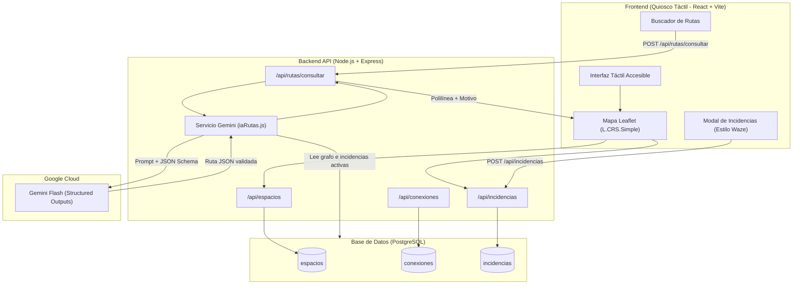
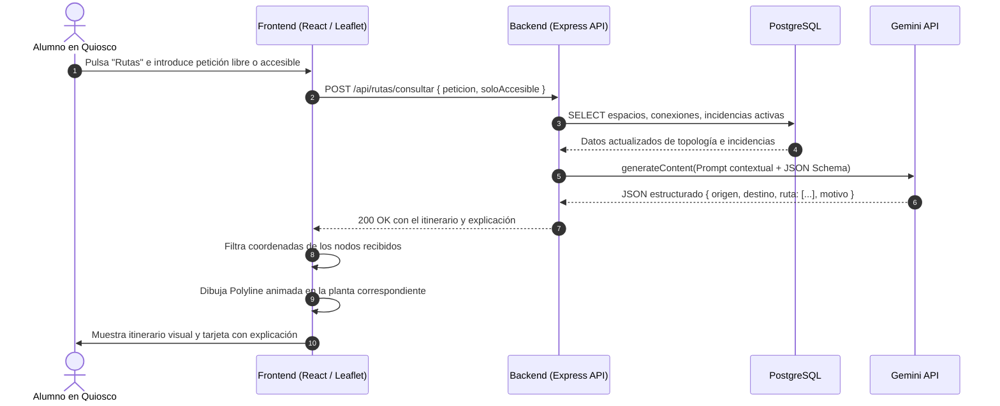

# Guía Técnica Completa de AccessiRoute
## Explicación de Arquitectura, Funcionamiento, Lenguajes y Justificación Tecnológica
**Proyecto Final de Ciclo Formativo de Grado Superior en Desarrollo de Aplicaciones Web (DAW)**

---

## 1. Visión General del Proyecto

### ¿Qué es AccessiRoute?
**AccessiRoute** es una aplicación web progresiva (**PWA**) diseñada para funcionar en **pantallas táctiles de pared / quioscos interactivos** situados en las entradas y pasillos de un centro educativo. Combina cuatro pilares fundamentales:
1. **Cartografía de interiores en 2D**: Visualización arquitectónica clara de las plantas del edificio sin depender de GPS externo.
2. **Navegación accesible asistida por IA**: Cálculo de rutas paso a paso que tienen en cuenta la movilidad reducida (sillas de ruedas, muletas, cochecitos), evitando escaleras mediante el uso de ascensores y rampas.
3. **Reporte colaborativo de incidencias (estilo Waze)**: Cualquier alumno o profesor puede tocar la pantalla táctil para marcar un ascensor averiado, una puerta bloqueada o un charco/obra.
4. **Respuesta adaptada en tiempo real**: La Inteligencia Artificial conoce las incidencias activas registradas en la base de datos y recalcula automáticamente los trayectos para esquivarlas.

---

## 2. Pila Tecnológica (Stack) y Justificación

| Capa | Tecnología | Lenguaje | ¿Por qué se eligió? |
|---|---|---|---|
| **Base de Datos** | **PostgreSQL** | SQL | Estructura relacional estricta para modelar un **grafo** (espacios como nodos y conexiones como aristas con clave foránea). Integridad referencial con `ON DELETE CASCADE` y compatibilidad nativa con tipos numéricos de coordenadas. |
| **Backend** | **Node.js + Express** | JavaScript (ES Modules) | Entorno asíncrono no bloqueante (event loop) ideal para operaciones I/O simultáneas (consultas a base de datos y llamadas externas a la API de Google Gemini). Sintaxis uniforme con el frontend en JavaScript moderno (`import/export`). |
| **Inteligencia Artificial** | **Google Gemini API** (`@google/genai`) | JSON / Prompting estructurado | Capacidad de razonamiento sobre grafos topológicos complejos y soporte nativo de **Structured Outputs** (salida forzada mediante esquema `Type.OBJECT`), garantizando respuestas JSON sin fallos de sintaxis ni alucinaciones de formato. |
| **Frontend** | **React + Vite** | JavaScript (JSX) + CSS3 | **React**: Modelo reactivo por componentes que permite actualizar el estado del mapa, las chinchetas de incidencias y los paneles flotantes de forma desacoplada.<br>**Vite**: Servidor de desarrollo ultrarrápido con Hot Module Replacement (HMR) y empaquetador ligero para producción. |
| **Mapa Interactivo** | **Leaflet** + **React-Leaflet** | JavaScript | Biblioteca ligera (~40 KB) especializada en cartografía. Soporta de forma nativa el sistema de coordenadas planas `L.CRS.Simple`, ideal para planos de planta 2D sin necesidad de cartografía satelital o servidores GIS pesados. |
| **Accesibilidad / UI** | **CSS3 Moderno + PWA** | CSS3 / HTML5 / Web APIs | Cumplimiento estricto del estándar **WCAG 2.1 AA** para pantallas táctiles: contraste cromático superior a 4.5:1, áreas de toque mínimas de 48×48 px y `manifest.json` para despliegue a pantalla completa (*kiosk mode*). |

---

## 3. Desglose Módulo por Módulo: Cómo se hace, Cómo funciona y Por qué



---

### Módulo 1: Base de Datos y Modelo de Grafo (PostgreSQL)

#### ¿En qué lenguaje se hace?
**SQL** ejecutado sobre el motor relacional **PostgreSQL**, ubicado en [backend/src/db/esquema.sql](file:///home/ajandaoui/DAW/Projecto/backend/src/db/esquema.sql).

#### ¿Por qué PostgreSQL y no una base de datos NoSQL como MongoDB?
Un centro educativo con aulas, pasillos, escaleras y ascensores es un **grafo topológico**. Las relaciones entre espacios deben ser estrictas:
- Si se elimina un aula o un ascensor, todas sus conexiones e incidencias asociadas deben borrarse en cascada (`ON DELETE CASCADE`) para evitar caminos rotos en el grafo.
- Las bases de datos relacionales garantizan la **integridad referencial** y consultas ACID inmediatas, fundamentales para que un reporte de incidencia bloquee al instante una ruta.

#### Estructura de las tablas:
1. **`espacios`**:
   - `id VARCHAR(50) PRIMARY KEY`: Clave semántica legible (ej. `'A-P1-AULA101'`, `'A-P1-BANO-H'`).
   - `nombre VARCHAR(100)`: Nombre para el usuario (*"Aula 101"*, *"Aseos Hombres Planta 1"*).
   - `bloque CHAR(1)`: Edificio (*'A'*, *'B'*, *'C'*, *'D'*).
   - `planta INT`: Planta física (*1* = Planta Baja, *2* = Primera Planta).
   - `tipo VARCHAR(30)`: Categoría (*'aula'*, *'pasillo'*, *'ascensor'*, *'escalera'*, *'bano'*, *'entrada'*).
   - `es_accesible BOOLEAN`: Indica si el propio espacio está libre de barreras arquitectónicas.
   - `coord_x FLOAT`, `coord_y FLOAT`: Coordenadas cartesianas en el plano 2D (rango 0 a 1000).
2. **`conexiones`**:
   - Representa las aristas del grafo. Cada fila conecta un `id_espacio_origen` con un `id_espacio_destino`.
   - `tipo_conexion`: Si la transición es por `'pasillo'`, `'puerta'`, `'escalera'` o `'ascensor'`.
   - `es_accesible`: `false` para escaleras tradicionales, `true` para rampas, pasillos planos y ascensores.
3. **`incidencias`**:
   - `id SERIAL PRIMARY KEY`.
   - `id_espacio REFERENCES espacios(id)`: Espacio arquitectónico afectado.
   - `tipo`: `'obstaculo'`, `'ascensor'`, `'puerta'`, `'rampa'`, `'paso_bloqueado'`, `'otro'`.
   - `estado`: `'activa'` o `'resuelta'`.
   - `coord_x`, `coord_y`: Posición milimétrica donde el usuario tocó la pantalla táctil.

---

### Módulo 2: Backend y Conexión de Datos (Node.js + Express)

#### ¿En qué lenguaje se hace?
**JavaScript moderno (Node.js con ES Modules `import/export`)**.

#### ¿Cómo funciona?
- Se utiliza la biblioteca oficial `pg` para crear un **Pool de conexiones** en [backend/src/db/conexion.js](file:///home/ajandaoui/DAW/Projecto/backend/src/db/conexion.js). El Pool reutiliza canales abiertos hacia PostgreSQL, reduciendo la latencia de cada petición HTTP a menos de 5 ms.
- Servidor Express en [backend/src/servidor.js](file:///home/ajandaoui/DAW/Projecto/backend/src/servidor.js) con middlewares de seguridad y utilidades:
  - `cors()`: Permite peticiones cruzadas desde el frontend (`http://localhost:5173`).
  - `express.json()`: Parsea cuerpos de petición en formato JSON.
  - Rutas modulares:
    - `GET /api/espacios`: Devuelve todos los espacios y sus coordenadas.
    - `GET /api/incidencias`: Devuelve las incidencias activas con datos del espacio (`JOIN`).
    - `POST /api/incidencias`: Crea una incidencia táctil reportada por un usuario.
    - `PATCH /api/incidencias/:id/resolver`: Marca una incidencia como resuelta.
    - `POST /api/rutas/consultar`: Invoca el motor de cálculo de rutas con IA.

---

### Módulo 3: Motor de Rutas Inteligente con Gemini AI

#### ¿En qué lenguaje se hace?
**JavaScript** utilizando el SDK oficial `@google/genai` en [backend/src/servicios/iaRutas.js](file:///home/ajandaoui/DAW/Projecto/backend/src/servicios/iaRutas.js).

#### ¿Por qué IA generativa en lugar de un algoritmo Dijkstra tradicional?
1. **Comprensión del lenguaje natural**: Un usuario no escribe código, escribe o dice por voz: *"Necesito ir al aula 103 pero voy con muletas y no puedo subir escaleras"*. Dijkstra no puede interpretar texto libre; Gemini extrae el origen implícito, el destino y la restricción de movilidad.
2. **Explicación comprensible para personas**: La IA no solo devuelve la lista de nodos, sino que genera una **explicación en lenguaje claro** adaptada a la situación (ej. *"Se ha seleccionado la ruta por el ascensor central de la planta baja para evitar el tramo de escaleras averiado"*).
3. **Respeto matemático del grafo gracias a Structured Outputs**: Tradicionalmente, los LLM podían "alucinar" nombres de aulas inexistentes. Con la función **Structured Outputs** de Gemini (`Type.OBJECT` con esquema JSON rígido), el modelo está forzado a responder estrictamente con un JSON que contiene:
   - `origen`: ID exacto.
   - `destino`: ID exacto.
   - `ruta`: Array de IDs contiguos registrados en la base de datos.
   - `barreras_evitadas`: Barreras esquivadas.
   - `motivo`: Frase explicativa en español.

#### ¿Cómo se ejecuta el cálculo de ruta?
1. El backend recibe la petición del usuario.
2. Consulta a PostgreSQL en tiempo real:
   - Lista completa de `espacios`.
   - Lista completa de `conexiones` disponibles.
   - Lista de `incidencias` activas.
3. Se inyecta esta topología en el prompt del sistema junto con las reglas:
   - *Regla 1*: Prohibido usar escaleras si se solicita accesibilidad.
   - *Regla 2*: Prohibido transitar por nodos que tengan una incidencia activa.
4. Gemini Flash calcula el itinerario óptimo y devuelve el JSON estructurado.
5. Si un modelo presenta congestión momentánea, el servicio implementa una cadena de reintentos automática (*fallback*) entre `gemini-3.5-flash`, `gemini-3.7-flash` y `gemini-3.8-flash`.

---

### Módulo 4: Plano Táctil Interactivo (Leaflet + L.CRS.Simple)

#### ¿En qué lenguaje se hace?
**JavaScript (React)** con la biblioteca **Leaflet** y componentes de `react-leaflet`, en [frontend/src/componentes/MapaCentro.jsx](file:///home/ajandaoui/DAW/Projecto/frontend/src/componentes/MapaCentro.jsx).

#### ¿Por qué `L.CRS.Simple` y no Google Maps o OpenStreetMap?
Los servicios cartográficos habituales (Google Maps, Mapbox) utilizan proyecciones terrestres EPSG:3857 (esféricas / GPS). Sin embargo:
- Los interiores de los edificios **no tienen señal GPS precisa** y no se rigen por latitud/longitud mundial.
- `L.CRS.Simple` define un plano cartesiano plano euclidiano en dos dimensiones $[0, 0]$ hasta $[1000, 1000]$.
- Esto permite posicionar puertas, aulas y pasillos con precisión milimétrica mediante píxeles relativos, cargando instantáneamente sin consumir cuotas de mapas externos.

#### Diferenciación visual de espacios por iconos accesibles:
Para garantizar que personas con dificultades cognitivas o de lectura comprendan el mapa rápidamente, cada tipo de espacio posee un icono y color semántico único:
- **Aulas de clase**: Azul (`#2563eb`)
- **Puertas y accesos**: Verde esmeralda (`#10b981`)
- **Aseos Hombres**: Azul cian (`#0284c7`)
- **Aseos Mujeres**: Rosa fucsia (`#db2777`)
- **Ascensores**: Violeta (`#8b5cf6`)
- **Escaleras**: Pizarra (`#64748b`)
- **Patio exterior**: Verde naturaleza (`#15803d`)
- **Sala de Actos**: Rosa (`#ec4899`)
- **Incidencias activas**: Rojo peligro pulsante (`#ef4444`)

---

### Módulo 5: Sistema de Incidencias Colaborativo (Estilo Waze)

#### ¿En qué lenguaje se hace?
**React (JSX)** en el cliente y **Express + PostgreSQL** en el servidor.

#### Flujo paso a paso de un reporte táctil:
1. El usuario pulsa el botón **Reportar** en la barra superior del quiosco.
2. Se abre el diálogo accesible [ModalReportar.jsx](file:///home/ajandaoui/DAW/Projecto/frontend/src/componentes/ModalReportar.jsx) con 6 botones táctiles de 64 px de altura: *Obstáculo*, *Ascensor*, *Puerta*, *Rampa*, *Paso Bloqueado* u *Otro*.
3. Al seleccionar un tipo, el mapa entra en **Modo Reporte Activo**:
   - Aparece un banner superior rojo: *"MODO REPORTE: Toca el plano para situar: [tipo]"*.
   - El componente `DetectorDeToques` captura el evento `click` o `touchstart` sobre el mapa usando el hook `useMapEvents` de Leaflet.
   - Se sitúa inmediatamente una chincheta roja temporal.
   - El frontend calcula mediante distancia euclidiana cuál es el espacio registrado más cercano al punto pulsado:
     $$\text{distancia} = \sqrt{(x_2 - x_1)^2 + (y_2 - y_1)^2}$$
4. Aparece una barra flotante inferior que muestra las coordenadas exactas y el aula más próxima.
5. Al pulsar **Confirmar Incidencia**, se despacha un `fetch` con método `POST` al endpoint `/api/incidencias`.
6. El backend almacena la incidencia en PostgreSQL y el mapa se actualiza reactivamente sin recargar la página (`actualizadorIncidencias`).
7. A partir de ese milisegundo, cualquier cálculo de ruta solicitado a Gemini evitará esa zona.

---

### Módulo 6: Interfaz Accesible y Preparación PWA

#### ¿En qué lenguaje se hace?
**CSS3 nativo** con variables CSS en [frontend/src/index.css](file:///home/ajandaoui/DAW/Projecto/frontend/src/index.css) y [frontend/public/manifest.json](file:///home/ajandaoui/DAW/Projecto/frontend/public/manifest.json).

#### Directrices de accesibilidad implementadas (WCAG 2.1 AA):
- **Tamaño de objetivos táctiles**: Todos los botones interactivos tienen un mínimo de `48px` de altura (generalmente entre `56px` y `64px`) para evitar pulsaciones erróneas de personas con temblores o dedos grandes.
- **Contraste de colores**: Fondo oscuro de alta visibilidad (`#0f172a`) con texto en blanco de alto contraste (`#f8fafc`), superando ampliamente la relación de contraste exigida de 4.5:1.
- **PWA Kiosk Mode**: Configurado en `manifest.json` con `"display": "standalone"`, permitiendo que el navegador se ejecute a pantalla completa sin barras de direcciones ni botones del sistema operativo.

---

## 4. Diagrama de Ciclo de Vida: Flujo de Consulta de Ruta con IA



---

## 5. Preguntas Clave para la Defensa del Proyecto (Comisión DAW)

### P1: "¿Por qué habéis usado Gemini API si podríais haber programado un algoritmo clásico como A* o Dijkstra en JavaScript?"
> **Respuesta:**
> *"Los algoritmos como Dijkstra o A\* son excelentes para grafos con pesos estáticos donde el origen y el destino ya son conocidos de antemano. Sin embargo, en un quiosco de uso público los usuarios se expresan en lenguaje natural (ej. 'vengo a matricularme a secretaría pero voy con un carrito de bebé').*
> *La Inteligencia Artificial permite dos cosas que Dijkstra no puede hacer: entender la intención humana con lenguaje no estructurado y generar una explicación verbal accesible de por qué se ha elegido ese itinerario. Además, al alimentar a Gemini con el grafo en tiempo real y aplicar Structured Outputs, combinamos la flexibilidad del lenguaje natural con la precisión topológica de un grafo."*

### P2: "¿Cómo garantizáis que la IA no alucine inventándose pasillos o aulas que no existen?"
> **Respuesta:**
> *"Mediante tres niveles de contención:*
> 1. *En el prompt del sistema se restringe explícitamente el espacio de búsqueda únicamente a los identificadores existentes en la base de datos.*
> 2. *Se implementa el modo nativo de **Structured Outputs** del SDK `@google/genai` con un esquema estricto (`Type.OBJECT` y `Type.ARRAY` de strings).*
> 3. *En el frontend, el componente `Polyline` valida que cada ID de la ruta devuelta coincida exactamente con las coordenadas de la base de datos antes de pintar cualquier trazo en el mapa."*

### P3: "¿Por qué utilizáis Leaflet con L.CRS.Simple en lugar de imágenes estáticas o Google Maps?"
> **Respuesta:**
> *"Google Maps está concebido para exteriores y proyecciones terrestres con latitud y longitud, donde la precisión del GPS bajo techo es nula o produce errores de decenas de metros. Por otro lado, una imagen estática no permite interactividad ni trazado dinámico de líneas vectoriales.*
> *`Leaflet` con `L.CRS.Simple` nos ofrece una cuadrícula bidimensional pura (0 a 1000) ligera, fluida a 60 fps en cualquier pantalla táctil o Raspberry Pi, y con soporte completo para marcadores interactivos, eventos táctiles y capas de plantas."*

---

## 6. Estructura de Directorios del Código Fuente

```text
Projecto/
├── backend/
│   ├── .env                      # Clave de Gemini y credenciales DB (seguro)
│   ├── package.json              # Dependencias: express, @google/genai, pg, dotenv
│   └── src/
│       ├── servidor.js           # Entrada principal Express y middlewares
│       ├── db/
│       │   ├── conexion.js       # Pool de conexiones a PostgreSQL
│       │   ├── esquema.sql       # DDL: tablas espacios, conexiones, incidencias
│       │   ├── semillas.sql      # Datos reales del centro (60 aulas, 122 aristas)
│       │   └── inicializar.js    # Script de inicialización de la base de datos
│       ├── rutas/
│       │   ├── espacios.js       # Endpoints GET de espacios
│       │   ├── conexiones.js     # Endpoints GET de conexiones
│       │   ├── incidencias.js    # Endpoints GET, POST, PATCH, DELETE de incidencias
│       │   └── rutas.js          # Endpoint POST de consulta asistida por IA
│       └── servicios/
│           └── iaRutas.js        # Integración con Google Gemini (Structured Outputs)
├── frontend/
│   ├── package.json              # Dependencias: react, react-dom, leaflet, react-leaflet
│   ├── vite.config.js            # Configuración de compilación con Vite
│   ├── public/
│   │   └── manifest.json         # Configuración PWA (kiosk/standalone)
│   └── src/
│       ├── main.jsx              # Montaje raíz del DOM en React
│       ├── App.jsx               # Estado global, orquestador de modales y mapa
│       ├── index.css             # Estilos WCAG 2.1 AA táctiles de alto contraste
│       └── componentes/
│           ├── MapaCentro.jsx    # Canvas Leaflet, iconos, detector de pulsación y chinchetas
│           ├── ModalRuta.jsx     # Búsqueda táctil de rutas y petición a la IA
│           └── ModalReportar.jsx # Selector táctil Waze de 6 tipos de incidencias
└── docs/
    ├── planificacion_y_modelo_conceptual.md # Memoria técnica inicial
    └── guia_tecnica_arquitectura_y_tecnologias.md # Este documento de referencia
```
