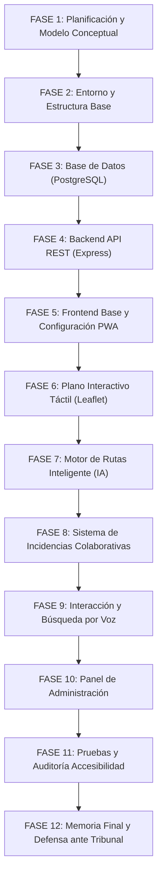
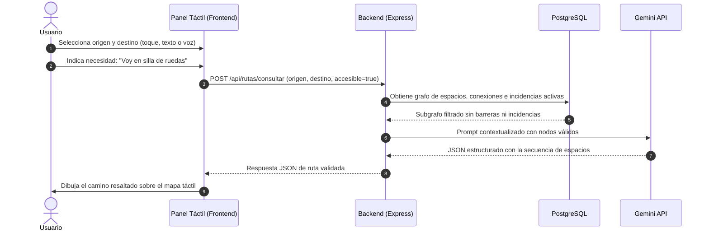
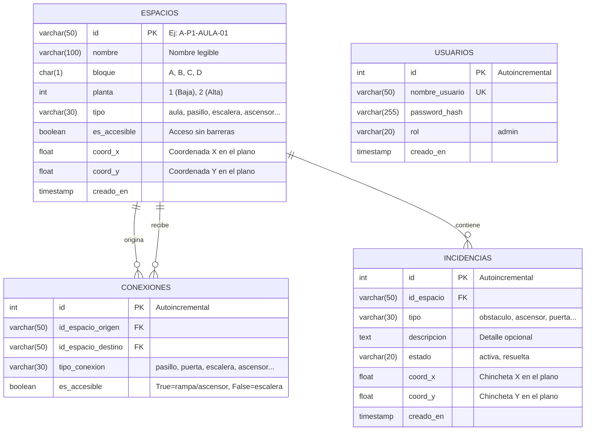

# AccessiRoute — Memoria Técnica Inicial
## Planificación, Modelo Conceptual y Arquitectura Base
**Proyecto de Fin de Ciclo Formativo de Grado Superior en Desarrollo de Aplicaciones Web (DAW)**

---

## 1. Introducción y Justificación del Proyecto

### 1.1. Contexto y Problemática
En los centros educativos actuales, el uso de teléfonos móviles personales está frecuentemente restringido o prohibido por normativa interna. Sin embargo, los centros suelen contar con múltiples edificios, plantas y desniveles que dificultan la orientación de nuevos alumnos, visitas y, muy especialmente, de **personas con movilidad reducida o necesidades específicas de accesibilidad**.

### 1.2. La Propuesta de AccessiRoute
**AccessiRoute** es una **PWA (Progressive Web App)** diseñada para ejecutarse en **paneles y terminales táctiles fijados en las paredes** de los pasillos y entradas del centro educativo.

El sistema integra:
* **Plano de interiores interactivo:** Navegación táctil intuitiva tipo "Google Maps" adaptada al plano del centro.
* **Accesibilidad universal como núcleo:** Rutas dinámicas que discriminan barreras arquitectónicas (escaleras vs. ascensores y rampas).
* **Gestión colaborativa de incidencias (estilo Waze):** Cualquier usuario puede reportar en segundos un obstáculo, puerta cerrada o ascensor averiado colocando un marcador sobre el plano.
* **Motor de rutas asistido por IA (Gemini API):** Interpreta peticiones en lenguaje natural y devuelve rutas estructuradas respetando el grafo y las restricciones de accesibilidad activas.
* **Interacción por voz (Web Speech API):** Permite a los usuarios solicitar indicaciones hablando directamente al panel táctil sin necesidad de teclear.

---

## 2. Gestión del Alcance y Planificación (~100 Horas)

Para garantizar la viabilidad y calidad técnica de un proyecto individual en aproximadamente 100 horas lectivas, el alcance se gestiona bajo una estricta jerarquía de prioridades:

### 2.1. Matriz de Priorización
| Nivel de Prioridad | Módulos y Funcionalidades | Justificación Académica |
| :--- | :--- | :--- |
| **PRIORIDAD 1 (Núcleo MVP)** | Plano táctil, modelo de espacios, rutas accesibles, integración con IA, reporte de incidencias | Constituye el corazón funcional defendible del proyecto. |
| **PRIORIDAD 2 (Complementos Clave)** | Instalación PWA, transcripción por voz en navegador, panel básico de administración | Aportan valor diferencial de usabilidad e interactividad. |
| **PRIORIDAD 3 (Mejoras)** | Filtros visuales avanzados, optimización visual cosmética | Solo se abordan una vez garantizado el funcionamiento del MVP. |

### 2.2. Exclusiones Explícitas (Fuera de Alcance del MVP)
Para evitar desviaciones de tiempo:
* No se utilizan sistemas GPS exteriores ni cartografía de ciudad (no aplican en interiores).
* No se requiere login previo para consultar rutas o reportar incidencias (enfoque de quiosco público rápido).
* No se entrena un modelo de IA desde cero; se aprovechan APIs fundacionales con salida JSON estructurada.
* No se implementan redes sociales, valoraciones ni chats internos.

### 2.3. Cronograma del Proyecto por Fases


---

## 3. Modelo Conceptual del Sistema

### 3.1. Arquitectura de Navegación por Grafo
En lugar de depender de sistemas GIS complejos, la infraestructura del centro se modela como un **grafo topológico**:
* **Nodos (`espacios`):** Puntos clave de paso o destino (aulas, entradas, descansillos, despachos, baños). Cada nodo posee coordenadas relativas `(X, Y)` para su representación sobre el plano.
* **Aristas (`conexiones`):** Pasillos, puertas, escaleras, rampas y ascensores que unen dos nodos. Cada arista cuenta con una propiedad booleana `es_accesible`:
  * *Ascensor / Rampa / Pasillo llano:* `es_accesible = true`
  * *Escalera:* `es_accesible = false`

### 3.2. Flujo de Navegación del Usuario en el Panel


### 3.3. Flujo Rápido de Incidencias (Estilo Waze)
Para paneles de pared, la agilidad es primordial:
1. El usuario pulsa el botón flotante destacado: **REPORTAR**.
2. Selecciona el tipo de incidencia mediante botones táctiles de gran tamaño (*Obstáculo, Ascensor, Puerta, Rampa, Paso Bloqueado, Otro*).
3. El plano entra en modo selección: el usuario arrastra con el dedo y coloca el marcador sobre el punto exacto.
4. Pulsa **Confirmar**.
5. La incidencia se guarda inmediatamente en PostgreSQL con estado `activa` y queda reflejada en tiempo real en los planos y en el contexto de navegación de la IA.

---

## 4. Estructura Base y Stack Tecnológico

### 4.1. Justificación de Decisiones Técnicas
* **Frontend — React + Vite:** Rápido tiempo de compilación, ecosistema modular de componentes y compatibilidad nativa para transformarse en PWA mediante service workers.
* **Backend — Node.js + Express.js:** Arquitectura asíncrona no bloqueante, idónea para coordinar peticiones concurrentes de consulta a BD y llamadas externas a la API de IA.
* **Base de Datos — PostgreSQL:** Cumplimiento estricto de integridad referencial ACID. El uso de `pg.Pool` garantiza reutilización eficiente de conexiones.
* **Visualización — Leaflet.js (`L.CRS.Simple`):** Permite renderizar imágenes del plano arquitectónico con soporte táctil nativo (zoom, arrastre, marcadores personalizados) sin coste de licencias ni dependencias de GPS exterior.
* **IA — Gemini API (Structured Outputs):** Permite razonar sobre restricciones de movilidad garantizando respuestas en formato JSON predecible sin alucinaciones.

### 4.2. Estructura de Directorios del Repositorio
```text
/home/ajandaoui/DAW/Projecto/
├── backend/
│   ├── .env                    # Variables de entorno locales (ignorado en Git)
│   ├── .env.example            # Plantilla pública de variables requeridas
│   ├── package.json            # Scripts de ejecución (start, dev, db:init)
│   └── src/
│       ├── server.js           # Punto de entrada Express, CORS y middlewares
│       └── db/
│           ├── conexion.js     # Pool de conexiones hacia PostgreSQL (pg)
│           ├── esquema.sql     # DDL de creación de tablas en español
│           ├── semillas.sql    # Datos y grafo de los 4 bloques del instituto
│           └── inicializar.js  # Script de inicialización y migración automática
├── frontend/
│   ├── index.html              # Plantilla base HTML5 con metaetiquetas viewport
│   ├── package.json            # Dependencias y scripts de Vite
│   ├── vite.config.js          # Configuración del bundler
│   └── src/
│       ├── main.jsx            # Montaje raíz de la aplicación React
│       ├── App.jsx             # Componente contenedor
│       └── index.css           # Estilos globales y variables de diseño
├── docs/                       # Documentación técnica y memoria
├── .gitignore                  # Exclusión de node_modules, dist y .env
└── README.md                   # Resumen del proyecto e instrucciones de instalación
```

---

## 5. Modelo de Datos Relacional (PostgreSQL)

### 5.1. Diagrama Entidad-Relación (ERD)


### 5.2. Mapeo Real del Centro Educativo
La base de datos cuenta actualmente con **56 espacios** y **114 conexiones** cargadas:
* **Bloque A (2 plantas):**
  * *Planta 1 (Baja):* Entrada principal, Secretaría, Sala de Actos, Pasillo Izquierdo (Aulas A-01 a A-05), Pasillo Derecho (Aulas A-06 a A-10), Escaleras (`es_accesible: false`) y Ascensor (`es_accesible: true`).
  * *Planta 2 (Alta):* Distribuidor central, Pasillo Izquierdo (Aulas A-11 a A-15) y Pasillo Derecho (Aulas A-16 a A-20).
* **Bloque B (2 plantas):**
  * *Planta 1:* Aulas B-01 a B-04, Baño accesible, Escalera y Ascensor.
  * *Planta 2:* Aulas B-05 a B-10, Escalera y Ascensor.
* **Bloque C (1 planta):** Despacho de Dirección y Secretaría.
* **Bloque D (1 planta):** Pabellón deportivo y gimnasio.
* **Patio Central Exterior:** Nodo exterior a cota cero que enlaza de manera accesible las entradas de los 4 bloques.

---

## 6. Principios de Accesibilidad y Usabilidad (UX para Paneles Táctiles)

1. **Diseño táctil en quiosco:** Todos los botones interactivos cuentan con un área mínima de toque de 48×48 px con espaciado generoso para evitar toques erróneos.
2. **Alto contraste y tipografía legible:** Jerarquía visual adaptada a personas de pie frente a una pantalla de pared a distancia media.
3. **No dependencia exclusiva del color:** Los estados de accesibilidad y las incidencias se comunican mediante combinación de icono reconocible, texto e indicador cromático.
4. **Multimodalidad:** Cada acción puede realizarse por tacto directo o mediante comandos de voz para usuarios con movilidad reducida en extremidades superiores.
